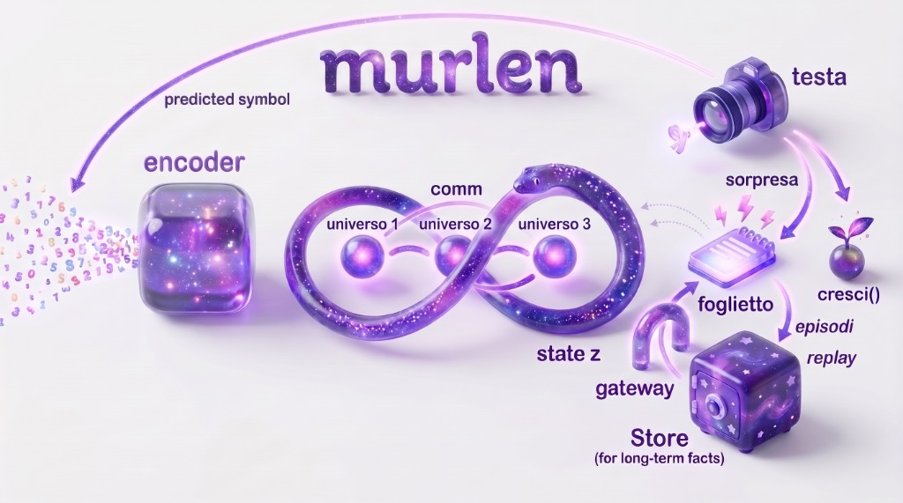

# MURLEN

**Multi-Universe Learning/Reasoning Network**: un modello che impara a **prevedere sequenze di simboli**, con una memoria persistente su file.

MURLEN è un **motore predittivo a voci multiple**: gli universi
sono ipotesi parallele sul mondo — il meccanismo del pensiero,
della simulazione (immaginare = far girare il modello a vuoto) e
del confronto fra interpretazioni (`Comm` è il "palcoscenico"
della global workspace theory: ogni universo espone una voce,
ogni slot sceglie chi ascoltare). `z`, lo stato portato fra i
blocchi, è la memoria di lavoro: volatile, riscritta di
continuo, con un gate che può proteggere slot dalla
riscrittura. Il deposito dei fatti a lungo termine è `store.py`,
e `gateway.py` è la porta che lo collega al foglietto: gli
episodi che lasciano tracce entrano nell'archivio nel sonno e
tornano come replay nel consolidamento.

MURLEN non lavora su testo, audio o video grezzi. Riceve **sequenze di numeri interi**, dove ogni numero è un simbolo (un glifo, un suono, ...), e impara a indovinare il simbolo successivo. Non riceve etichette: il segnale di apprendimento è l'errore di predizione (la "sorpresa").

La trasformazione dei dati (testo, immagini, audio) in simboli **non** è compito di MURLEN: deve avvenire prima, fuori da MURLEN.

```
sequenze di simboli (id interi)  ->  MURLEN (predizione + memoria)
```

Licenza: [BUSL 1.1](LICENSE) — libera per uso non commerciale (ricerca, studio, no-profit); le aziende che vogliono farne uso commerciale devono acquistare una licenza. Quattro anni dopo la pubblicazione ogni versione diventa automaticamente **GPL-3.0-or-later**: resta open source per sempre.



## Struttura

| File | Ruolo |
|------|-------|
| `model.py` | Il nucleo: `MultiUniverse`, rete neurale con K universi |
| `ponte.py` | Converte i simboli in token e allena la predizione del simbolo successivo |
| `store.py` | Memoria persistente delle regole (file JSONL append-only) |
| `gateway.py` | La porta fra il foglietto e l'archivio: episodi fuori, replay dentro |

### `model.py`: MultiUniverse

- **Encoder** transformer condiviso: `D=384`, `8` layer, `8` teste, contesto massimo `CTX=1024` simboli.
- **K universi**: ogni universo ha uno stato latente privato di `M=32` slot e un proprio blocco di aggiornamento (`UpdK`). L'aggiornamento è ripetuto `T=4` volte.
- **Nascita degli universi** (`init`): come parte `z` all'inizio di ogni forward.
  - `'learned'` (default): ogni universo ha un'identità ereditaria — un embedding `E_k` appreso, diverso per universo — più una proiezione del contenuto della sequenza, uguale per tutti. Gli universi nascono già diversi.
  - `'projected'`: gli universi nascono identici (`z=0`). Query condivise leggono l'input e ogni universo ha una propria mappa `W_k` inizializzata a zero: la diversità nasce solo dal gradiente (pesi separati + jitter).
  La scelta è strutturale: le due forme hanno parametri diversi e un checkpoint non si converte. Misurato (`confronto_init`, 3 semi, sia nati a `K` sia cresciuti da 1 con `cresci()`): loss equivalente entro il rumore dei semi in entrambi gli scenari — la scelta è di disegno, non di prestazione.
- **Asimmetria fra universi**: durante il training ogni universo riceve una versione dell'input leggermente rumorosa (`JITTER=0.1`).
- **Comunicazione** (`comm=True`): ogni universo espone un riassunto del proprio stato (la sua "voce"); sul canale passa solo la deviazione dal coro — ciò che una voce dice di diverso dalle altre. Ogni slot di ogni universo legge le voci per contenuto (`Comm`, cross-attention): chi ascolta chi dipende dal contesto, non da un voto globale. Attiva di default con `K>1`; va decisa alla creazione del modello.
- **Modalità ricorrente** (`tempo=N`): la sequenza viene elaborata a blocchi di N simboli; lo stato degli universi passa da un blocco al successivo — sia via `zinj` (broadcast) sia via `zread` (lettura a contenuto: ogni posizione interroga gli slot di `z`). Ogni slot ha un gate proprio che può rallentarne la riscrittura fino a proteggerlo. Di default `tempo=64` con `K>1` (`TEMPO_UNIVERSI`) e `tempo=0` con `K=1`.
- **Foglietto** (`foglio`, attivo quando `tempo>0`): memoria episodica indirizzata a contenuto. Dopo ogni finestra `annota(h, sorpresa, pad)` consolida le posizioni il cui simbolo era imprevisto (fence dei quartili sulla distribuzione delle sorprese, più il confine d'episodio): lasciano una traccia snapshot che le posizioni successive interrogano per contenuto, anche oltre il contesto. Il canale sta su `foglio.lam` come `comm`. Si passa fra finestre con `mem0` — distinto da `z0`: si possono ablazionare separatamente. In `impara_predizione` la scrittura avviene dentro il `forward`, a ogni blocco di `tempo`: l'organo si allena anche dentro una finestra sola. Capienza `MEM_CAP=256` tracce. Variante `mem_gate=True`: la scelta di cosa scrivere è appresa da un gate sigmoide invece del fence dei quartili — misurata apprendibile sulla sonda a due fatti (`tests/universi_gate.py`, 1a giunzione sotto il caso su due seed). Misurato: trasporta un fatto discreto oltre ~500 simboli (dove `z` non ci riesce); il binding di due fatti insieme è appreso solo parzialmente. Variante `coppia=True`: la traccia è indicizzata dal binding discreto della coppia di simboli `(s_{p-1}, s_p)` — ogni coppia distinta lascia una traccia una volta sola (le ripetizioni no), la riga è `(chiave 2d, h)` e la lettura proietta `h` nello spazio chiave con `qpair`; `lam` parte a 1.0 perché l'init muto si chiude da solo (letture casuali peggiorano la loss → il gate si abbassa → niente gradiente sull'indirizzamento). Sotto-variante `ancora=True`: metà sinistra della query è l'embedding del simbolo corrente (filtro di famiglia senza apprendimento), solo la metà destra si impara, zero-init. Sotto-variante `simbolo=True`: il valore della riga è `emb(s_p)` al posto di `h` — il contenuto richiamato è il simbolo stesso (già metà destra della chiave), non lo stato che lo prediceva: la traccia risponde in spazio vocabolario e la testa, essendo lineare, fa da un-embedding appreso.
- **Crescita** (`cresci()`): aggiunge un universo con "voce" inizialmente muta (pesi a zero). Passando da 1 a 2 universi accende da sola comunicazione (anch'essa muta all'inizio) e `tempo=64`, se non sono stati scelti alla creazione. Funziona con entrambi gli `init` (`'learned'` e `'projected'`). Può scattare da sola durante il training: vedi `vigilanza` in `impara_predizione`.
- **Compatibilità**: i checkpoint vecchi, con un unico blocco di aggiornamento condiviso, vengono caricati copiando quel blocco in ogni universo.

`forward(ids, pad, causal=False, z0=None, mem0=None, scrivi=None)` restituisce `(z, h)`:
- `z`: stato finale degli universi, forma `(B, K, M, D)`;
- `h`: rappresentazione della sequenza, forma `(B, N, D)`.

`z0` e `mem0` portano lo stato da una chiamata all'altra: se malformati vengono scartati e si riparte da zero, senza errori. `annota(...)` restituisce le tracce da ripassare alla chiamata seguente come `mem0` — ma solo nella modalità a finestra: a blocchi è il `forward` stesso a chiamarla e i ritorni si perdono nel flusso, quindi lo stato si legge con la proprietà `core.mem` — non serve comunque toccare `_mem`. `scrivi` è il gancio usato da `impara_predizione` per consolidare il foglietto dentro il forward; lasciarlo `None` mantiene il comportamento a finestre.

`z` e le tracce **non** sono nello `state_dict`: sono stato di runtime, non pesi appresi. `torch.save(m.state_dict())` salva la conoscenza ma non "dove era arrivato il pensiero" — al caricamento `z` riparte da zero e il foglietto è vuoto (come un risveglio). Per riprendere con continuità si passano `z` e `mem` a `salva_sicuro` (vedi `ponte.py`), che li stacca dal grafo da sé.

Le dimensioni si scelgono quando si crea il modello; se non si indicano valgono le costanti in cima a `model.py`:

```python
core = MultiUniverse(vocab, K=3, comm=True, init='projected',
                     d=512, m=32, nhead=8, ctx=1024,
                     enc_layers=12, T=4, jitter=0.1)
```

`d` deve essere divisibile per `nhead`. Un checkpoint va ricaricato in un modello creato con le stesse dimensioni.

### `ponte.py`: simboli -> predizione

- `vocab_da_sequenze(seqs)`: mappa i simboli visti su id contigui (gli id `0` e `1` restano riservati, `1`=PAD).
- `tensorizza(seqs, vocab, ctx)`: crea i tensori di id e la maschera di padding.
- `impara_predizione(core, seqs, vocab, passi, ..., batch=None, seed=0)`: allena il modello a predire il simbolo successivo (cross-entropy, AdamW, gradient clipping). Restituisce lo storico della loss e la testa di predizione.
  - `ctx`: simboli per sequenza; `None` = il contesto del modello (non può superarlo).
  - `testa`: la testa restituita da una chiamata precedente, per continuare ad allenarla invece di ripartire da zero (utile per allenare a puntate, per esempio prima e dopo `cresci()`).
  - `riscaldamento`: nei primi passi `lr` sale gradualmente fino al valore scelto (`None` = un quinto dei passi, al massimo 200; `0` = `lr` fisso). Evita che l'addestramento si blocchi all'inizio con `lr` alti.
  - `batch`: sequenze per passo al massimo (mini-batch, rimescolate con `seed`); `None` = tutte insieme.
  - `vigilanza`: soglia di sorpresa assoluta — se la loss resta sopra per `pazienza` passi consecutivi, gli universi presenti non spiegano i dati e `cresci()` scatta da sola (l'optimizer viene ricreato con il lr corrente). `universi_max` ferma la crescita (`8` di default). `None` = crescita solo manuale.
  - `diversita`: peso della repulsione fra le voci (`0` = spenta). Se `>0`, le voci troppo simili fra loro pagano in loss — pressione perché ogni universo dica qualcosa di diverso, così parlarsi conviene.
  - Su GPU il batch è adattivo: a ogni passo riempie la VRAM libera in quel momento, scende se altri programmi (browser, desktop) la occupano e risale quando la liberano. Se la memoria viene rifiutata a passo in corso, il passo si ripete con le sequenze che ci stanno; se non ne sta nemmeno una, aspetta che la VRAM si liberi (`ATTESA_MAX`, 5 minuti). Resta sempre libero un margine del 5% (`MARGINE`).
  - Il padding arriva solo fino alla sequenza più lunga del gruppo, non fino a `ctx`; i tensori vengono creati per-batch, non sull'intero corpus.
  - Sequenze di meno di due simboli vengono saltate (non hanno input→target); se non ne resta nessuna solleva `ValueError`.
  - Con `tempo=0` (o `tempo` maggiore della lunghezza della sequenza) gli universi non influiscono sulla predizione e non vengono calcolati.
- `salva_sicuro(core, path, testa=None, z=None, mem=None)` / `carica_sicuro(core, path, testa=None)`: checkpoint con garanzie — ogni tensore dev'essere finito (mai NaN su disco; se non lo è il salvataggio è rifiutato e il file precedente resta intatto), la scrittura è atomica (`.tmp` + `os.replace`: mai un file a metà), e il file precedente diventa `path+'.prev'` — l'ultimo sano resta sempre. In caricamento un file corrotto/troncato/non finito fa ripiegare su `.prev`. Restituisce `True`/`False` (salva) e il dict con `z`/`mem` o `None` (carica). `z` e `mem` vengono staccati dal grafo da soli.

### `store.py`: memoria

File JSONL **append-only**: niente viene sovrascritto, ogni cambiamento aggiunge una riga. Ogni regola segue un ciclo di vita:

```
candidata --(>= m_consolida conferme dopo la prima osservazione, default 2)--> consolidata
    |                              |
    +------ controesempio ---------+--> declassata
candidata mai confermata e vecchia --> dimenticata
```

La soglia si sceglie per ogni memoria e si può cambiare in qualsiasi momento: `Store('ascolta.jsonl', m_consolida=4)`, poi `st.m_consolida = 3`. Così ogni canale (lettura, ascolto, visione) può avere la sua.

Metodi principali: `add`, `conferma`, `contraddice`, `revidi`, `simili`, `attive`, `consolidate`, `dimentica`, `audit`, `close`. Nota su `attive`: senza famiglia restituisce solo i record `tipo='regola'`; con famiglia restituisce tutti i tipi — serve a `dimentica`, che deve far decadere anche gli episodi. `simili` richiama per campi uguali fra i parametri, solo sullo stato corrente di ogni regola (le versioni storiche non contano), con un piccolo rinforzo per le regole già confermate; l'indice invertito sui campi evita di scansionare lo store intero.
Lo store tiene un handle di append persistente (`close()` lo rilascia, altrimenti alla fine del processo). Le query stanno sugli indici in RAM (`_by_id` stato corrente, `_inv` campi, `_by_n` conferme per famiglia); il file si rilegge solo all'avvio.
Se il processo viene interrotto a metà scrittura, la riga incompleta viene eliminata al caricamento.

### `gateway.py`: la porta episodi <-> archivio

Message broker bidirezionale fra le tracce del foglietto e lo Store. Le tracce sono vettori `h` senza simboli: l'episodio archiviabile è la finestra che le ha prodotte, catturata al confine.

- `Gateway(store)` — il broker si costruisce su uno Store esistente.
- `veglia(ids, sorpresa, pad, foglio)` — annota come episodi del giorno le finestre vissute che hanno lasciato tracce oltre al confine d'episodio (sempre tracciato). La scelta "cosa merita memoria" resta del foglietto (il suo fence dei quartili): qui si chiede solo *questa finestra ha scritto?*. Gli episodi sono simboli grezzi, nessuna interpretazione.
- `sonno(recenti=None)` — consegna gli episodi all'archivio (record `tipo='episodio'`; ri-osservare gli stessi simboli nel mondo è una conferma vera, decisa per identità), fa decadere i mai-rinforzati (`dimentica`), e restituisce il materiale di **replay**: gli episodi attivi in ordine di nascita, pronti da rimescolare nelle `seqs` di `impara_predizione`. Il replay è la via che densifica le letture per indirizzo — il carico che il canale episodico richiede (vedi `sonda_scala_n32`).

Il buffer del giorno è in RAM: un processo che muore prima del sonno perde gli episodi non consegnati. Copre il percorso a fence; la variante `mem_gate` non è ancora agganciata. Il ritmo veglia/sonno (quando dormire) non è compito di questo modulo: vive nell'organismo (`mimo/cervello/`).

## Requisiti

- Python 3.8+
- [PyTorch](https://pytorch.org/get-started/locally/)

```bash
pip install torch
```

### GPU

Con una scheda NVIDIA basta passare `device='cuda'` a `impara_predizione`. Serve una build di PyTorch con CUDA adatta al driver e alla scheda, ad esempio per una GTX 1050 Ti con driver CUDA 12.4:

```bash
python3 -m venv .venv
.venv/bin/pip install torch==2.6.0 --index-url https://download.pytorch.org/whl/cu124
```

Il batch si adatta da solo alla VRAM libera (vedi `impara_predizione`): non serve sceglierlo a mano.

## Esempio d'uso

Da eseguire dalla cartella che **contiene** `murlen/`:

```python
from murlen.model import MultiUniverse, param_count
from murlen.ponte import vocab_da_sequenze, impara_predizione

# sequenze di simboli
seqs = [[12, 40, 40, 7, 3], [12, 40, 9, 7], [5, 3, 12, 40]]

vocab, n_vocab = vocab_da_sequenze(seqs)
core = MultiUniverse(n_vocab, K=3, comm=True)
print(param_count(core), "parametri")

storico, testa = impara_predizione(core, seqs, vocab, passi=50, batch=2)
print("loss iniziale", storico[0], "-> finale", storico[-1])
```

Memoria:

```python
from murlen.store import Store

st = Store("memoria.jsonl")
r = st.add("trasformazione", "alternanza", {"da": 9, "a": 1}, "osservazione")
st.conferma(r)
st.conferma(r)  # -> consolidata
print(st.audit())
```

## Test

Dalla cartella che contiene `murlen/`:

```bash
pip install pytest
python -m pytest murlen/tests          # test
python murlen/tests/bench.py [cuda]    # tempo per passo di training (CPU o GPU)
```

`tests/dati/riferimento_ponte.json` contiene lo storico della loss del codice prima delle ottimizzazioni: `test_stesso_risultato_di_prima` verifica che l'apprendimento non sia cambiato. I test in `test_gpu.py` vengono saltati se CUDA non è disponibile.

Gli script `tests/universi_*.py` e `confronto_init.py` non sono test di regressione ma **esperimenti di misura** con ablazioni (sono lenti, vanno su GPU): `universi_dialogo.py` la cooperazione (curriculum sul dialogo; zittire la comm deve costare), `universi_chiave.py` la memoria a lungo raggio, `universi_catena.py` il reasoning a catena, `universi_gate.py` la scrittura a gate appreso del foglietto, `universi_ruoli.py` la specializzazione, `universi_libro.py` e `universi_libro_finestre.py` la misura su libri veri, `universi_parlano.py` e `universi_oltre_finestra.py` le varianti sintetiche, `confronto_init.py` il confronto `learned`/`projected`. `universi_prosegui.py` e `universi_dialogo_prosegui.py` continuano l'allenamento da un checkpoint salvato; `riferimento.py` rigenera il baseline della regressione (solo sul codice di riferimento). I risultati stanno in `tests/dati/*.txt`.

## Cosa MURLEN non fa

- Non legge file audio, immagini o video: servono simboli già estratti.
- Non genera testo, audio o video: prevede solo il simbolo successivo.
- Non segmenta le sequenze in parole e non scopre regole in automatico: `store.py` fornisce la memoria e `gateway.py` la riempie di **episodi** (le finestre che hanno lasciato tracce); le *regole* restano da scrivere dall'esterno.

## Problemi noti

- **`cresci()` e optimizer**: dopo una `cresci()` chiamata a mano l'optimizer va ricreato, perché i nuovi parametri non sono inclusi. Con `vigilanza` lo fa `impara_predizione` da sola.
- **`Store.add`**: una regola dimenticata o declassata che viene riosservata non torna attiva.
- **Universi e training**: con `tempo=0` `impara_predizione` non allena gli universi (vedrebbero il simbolo da indovinare). Con `K>1` il default è già `tempo=64`; un modello nato con `K=1` li ottiene con `cresci()`, salvo `comm=False`/`tempo=0` scelti alla creazione.
- **Comunicazione fra universi**: su next-symbol puro (sintetico e libri veri in 3 lingue) `lam` impara a scendere e zittirla non cambia la loss — il canale esiste ma non serve (`tests/universi_libro.py`, `universi_parlano.py`). Sul compito a catena — ogni giunzione aggiorna lo stato che serve alla successiva — zittirla **più che raddoppia** l'errore sulle giunzioni (0.17→0.42): quando lo stato evolve e va passato fra passi d'inferenza, la cooperazione è il canale portante, non un'opzione (`tests/universi_catena.py`).
- **`z` non trasporta fatti discreti**: lo stato porta continuità locale oltre il contesto, ma informazione discreta a lungo raggio no — misurato su compiti a chiave, marche e dialogo. `z` è memoria di lavoro, non archivio: il trasporto dei fatti è del **foglietto**, misurato su uno e due fatti legati insieme (dialogo: 1a giunzione di finestra 2 sotto il caso solo col foglietto — 1.27 vs 1.39 a fatto singolo, 2.61 vs 2.77 con binding a due; dimenticarlo o spegnerne `lam` la riporta sopra il caso). Serve allenamento a curriculum e passi sufficienti (`tests/universi_dialogo.py` — fatto singolo, `tests/universi_dialogo_prosegui.py` — binding a due). Con la scrittura a gate appreso (`mem_gate`) il positivo si replica su due seed: 1a giunzione 2.09–2.60 contro caso 2.773, e spegnere il foglietto la riporta a ~3.0-3.2 (`tests/universi_gate.py`).
- **Ruoli degli universi**: nessuna specializzazione pulita (né per lingua né per partito), ma sul dialogo compaiono effetti selettivi per tipo di risposta — per esempio zittire un universo dimezza la loss di una giunzione specifica e la peggiora su un'altra. Differenziazione funzionale embrionale, non ruoli (`tests/universi_ruoli.py`).
- **Reasoning a catena**: misurato positivo — ogni giunzione produce lo stato per la successiva; il foglietto trasporta lo stato *calcolato* oltre il confine (1a giunzione di finestra 2: 2.24 vs caso 2.77; dimenticato: 3.2-3.8) e la catena prosegue in finestra 2 (giunzioni 0.17). È il livello più basso di inferenza multi-passo, ma è verificato (`tests/universi_catena.py`, `universi_prosegui.py`).
- **Su testo vero gli organi non servono (ancora)**: su finestre consecutive di libri in 3 lingue (1000 passi, caratteri), portare z+foglietto non aiuta e anzi costa un filo (+0.005-0.02). Verdetto ora solido: con il foglietto allenato dentro il forward `lam` **scende** da solo (~0.075→0.056) — dove le tracce sono ridondanti rispetto all'encoder il modello stesso chiude l'organo. Coerente col quadro: i meccanismi si accendono su compiti con fatti che ritornano; sul testo naturale a questa scala il segnale memoria è debole (`tests/universi_libro_finestre.py`, `universi_libro.py`).

## Costanti di default

| Nome | Valore | Cosa vuol dire |
|---|---|---|
| `D` | 384 | Ogni simbolo viene rappresentato con 384 numeri, come una "descrizione" del simbolo. Più è grande, più sfumature può cogliere, ma serve più memoria. |
| `M` | 32 | Ogni universo ha 32 "caselle" in cui tiene il suo stato, come 32 appunti. |
| `NHEAD` | 8 | Quando guarda la sequenza, la rete osserva 8 aspetti diversi contemporaneamente, come 8 paia di occhi che cercano cose diverse. |
| `CTX` | 1024 | Quanti simboli vede insieme al massimo. |
| `ENC_LAYERS` | 8 | L'encoder è fatto di 8 strati uno sopra l'altro: ogni strato rielabora ciò che ha capito quello sotto. |
| `T_DEFAULT` | 4 | Ogni universo "ripensa" 4 volte a ciò che ha visto prima di dare la risposta. |
| `TEMPO_UNIVERSI` | 64 | Con `K>1` la sequenza viene elaborata a blocchi di 64 simboli; lo stato `z` passa da un blocco al successivo. |
| `MEM_CAP` | 256 | Quante tracce tiene al massimo il foglietto episodico; le più vecchie cadono. Sovrascrivibile col parametro `mem_cap` del costruttore. |
| `JITTER` | 0.1 | Durante l'addestramento ogni universo riceve l'input con un 10% di rumore diverso. Così gli universi non diventano copie identiche (con 0 collassano). |

## Dimensionamento

| Dati | Consiglio |
|---|---|
| Pochi (migliaia o milioni di simboli) | Modello più piccolo, per esempio `d=256` e `enc_layers=4`. Così com'è imparerebbe a memoria invece di capire le regole. |
| Tanti (centinaia di milioni) | I valori di default vanno bene. |

## Capacità: misurate vs dichiarate

Sweep `tests/scala.py`: 12 assi × 3 valori × 2 seed, compito 200 fatti a distanza 200, L=1024, 120 passi. `ce_ric` è la loss sulle posizioni dei fatti da richiamare (default 7.142). Carico breve: contano le differenze grandi, non i valori assoluti.

| Parametro | Misura (`ce_ric`) | Verdetto |
|---|---|---|
| `ctx` | 256→7.48, 1024→7.14, 2048→6.96 | Unico ginocchio netto: sotto la distanza dei fatti costa. Oltre il doppio, guadagno modesto |
| `K` | 1→7.01, 2→7.14, 8→6.58 | Più voci aiutano il richiamo: miglior `ce_ric` dello sweep |
| `lr` | 1e-4→6.55, 3e-4→7.14, 1e-3→7.04 | Basso paga sul richiamo |
| `clip` | 0.5→6.63, 1→7.14, 4→6.84 | Stretto paga. In `ponte.py` il soffitto ora esce dal fence dei quartili sulle norme osservate (`NORME_STORIA=200`), non da un numero |
| `d` | 96→6.73, 384→7.14, 768→7.44 | A 120 passi il grosso impara più lento, non meglio. A 840 passi (`sonda_vigilanza`) d=96 raggiunge ~0.5 come d=384: lentezza, non saturazione |
| `enc_layers`, `m`, `nhead`, `T`, `tempo`, `jitter` | spread ~0.1–0.6 | Piatti o rumorosi a questo carico |
| `MEM_CAP` | identico a ogni valore | Il FIFO è verificato lato scrittura: 8/32/64/121 tracce ai rispettivi cap. Sul costo: il lettore indirizzato ora esiste (sonda_scala_indirizzo, 2000 passi) — la misura di costo va rifatta su quel carico |

Sonde dedicate (`tests/sonda_*.py`, risultati in `tests/dati/`):

- **`sonda_campo` / `sonda_campo_libro`** — il bordo di finestra esiste (posizioni iniziali più sorprendenti), ma su testo vero `z`+foglietto lo compensano del tutto (gap residuo ~0). `ctx` resta una taglia di nascita: nessuna crescita in vita giustificata dalla misura.
- **`sonda_sviluppo`** — E1: un modello nato K=1 impara più in fretta di uno nato K=3 (1.53 vs 1.75); la vigilanza non è mai scattata perché la loss era già bassa. E2: il gap d=96/d=384 a 340 passi (1.07) si chiude a 840 — nessuna saturazione strutturale misurata.
- **`sonda_vigilanza`** — la vigilanza a soglia assoluta è cieca alla saturazione: la loss scende sotto la mediana di warmup e ci resta, mai scattata. Il segnale giusto sarebbe lo stallo (pendenza): separabile — plateau Q3=0.09 vs apprendimento Q1=0.15 — ma va testato su un carico dove la saturazione esiste davvero.
- **`sonda_memcap` / `sonda_lettore` / `sonda_lettore_min` / `sonda_lettore_libro`** — il lettore del foglietto a 500 passi: **non si forma** su compiti-esame (piatto a 1–60 fatti, fence o gate appreso, diretto o curriculum) né su testo vero alle posizioni di riuso (2.935 ≈ 2.934 ≈ 2.935). Verdetto poi ribaltato dalla sonda di scala: era tempo, non struttura (vedi `sonda_scala_indirizzo`).
- **`sonda_lettore_fattori`** — quando nasce il lettore *posizionale*: la variabile decisiva è **quante volte lo stesso fatto viene letto per episodio**. Uso fitto → lettura di contenuto sempre; uso singolo → mai (intatto ≈ episodio-1). Curriculum irrilevante, binding arbitrario costa ma non uccide.
- **`sonda_lettore_densita`** — il ginocchio è **basso**: senza curriculum, copia si legge già a 2 letture/fatto (0.01 vs 1.61/4.84), tabella arbitraria a 4 (0.10 vs 2.71/5.69); a 1-2 letture è piatto o incipiente. Conclusione: il libro piatto non dipende dalla densità di riuso — alle posizioni di riuso il testo è prevedibile dal contesto locale, la memoria non è load-bearing e il canale non riceve gradiente. Il lettore nasce solo dove la traccia è l'unica via alla predizione.
- **`sonda_lettore_molti` / `sonda_lettore_indirizzo` / `sonda_pressione_indirizzo`** — il recall **indirizzato** (cercare il fatto per marca, non per posizione): a 500 passi non emerge mai — né con marche dedicate senza ambiguità, né sotto pressione massima (~63 letture/fatto, metà della loss sulle giunzioni). Le uniche vie che emergono: slot posizionale a fatto unico, induzione in-window, tabella piccola in `z` (multi-fatto ciclico, 0.58 senza foglietto). Sulle **prime occorrenze** per finestra — le uniche posizioni load-bearing — risposta al caso in ogni ablazione.
- **`sonda_scala_indirizzo`** — **il ribaltamento**: stesso compito indirizzato a N=8, ma 2000 passi invece di 500. Sulle prime occorrenze: intatto **0.41** vs caso 3.0, svuotato 3.82, episodio-1 6.81 (tracce sbagliate → risposta sicura e sbagliata: recall veramente a contenuto), senza-z 0.39 (è il foglietto, non z). Verdetto: il canale indirizzato **esiste** — costa ~4× il training della lettura posizionale; tutti i "non nasce" precedenti erano sotto-allenati, non strutturali.
- **`sonda_lettore_lungo`** — il test sul mondo vero: 14 romanzi lunghi (~10.5M caratteri), pezzi da 8 finestre, d=384/8layers, **2000 passi**, 752 posizioni di riuso oltre CAMPO (87% deterministico). Risultato: **piatto** — il riuso deterministico è già prevedibile dai pesi (CE 0.78 con o senza memoria), e le posizioni dove la traccia è l'unica via sono troppo rare per fatto (~1-2 letture) per allenare il canale. **Verdetto finale della serie**: il lettore esiste e sa leggere a contenuto, ma il carico naturale del testo non lo allena — il riuso o è prevedibile o non si ripete abbastanza. Per MIMO: la memoria si allena col comportamento sul testo (ri-letture, interrogazioni), non col testo in fila.
- **`sonda_saturazione_vera`** — nessuna saturazione strutturale a nessun corpo: anche **d=96** forma il recall indirizzato (prima 0.86 vs caso 3.0); e a d=192 la lettura è quasi perfetta (0.003, episodio-1 9.33). Trovata però una **divisione del lavoro emergente**: a d=96 z e foglietto cooperano (togliere z costa più che togliere il foglietto); a d≥192 il foglietto si specializza e z diventa ridondante.
- **`sonda_replay`** — il ciclo veglia/sonno degli organi sul muro N=32: veglia in eval + notti con replay dallo Store. **Verdetto negativo e istruttivo**: replay verbatim = catastrophic forgetting + memorizzazione (`prima` 6.6, peggio del caso 3.0 — il controllo fresco resta 3.008). I pesi memorizzano gli episodi ripetuti e la memorizzazione *toglie* pressione al canale di lettura: le risposte vengono dai pesi, non dalla traccia. Il replay che serve è la re-interrogazione, non la ri-lettura identica.
- **`sonda_scala_n32`** — **il primo muro di capacità misurato**: a parità di tutto (d=384, 2000 passi, ~480 letture indirizzate/episodio), il lettore nasce a N=8 (~63 letture/fatto) ma **non a N=32** (~15/fatto). Il vincolo è la **densità per indirizzo**, non l'aggregato: il canale si allena solo se lo stesso fatto viene interrogato molte volte. È esattamente la geometria dei libri (molti fatti × 1-2 letture) — il motivo profondo per cui il testo naturale non accende il lettore.
- **`sonda_densita_n32` + `check_copertura` / `check_distinzione` / `check_firme`** — la confutazione della diagnosi precedente: a N=32 con ~60 letture/fatto il lettore resta piatto (`prima` 3.105 ≈ caso) — **non** era densità. Le tre misure scompongono il muro: il fence affama sotto novità uniforme (2-5 fatti su 32 tracciati), la scrittura per distanza-dal-buffer alluviona (255/finestra vs `MEM_CAP`), e la firma `h` per-fatto è reale ma troppo debole per indirizzare (4.9% vs caso 3.1%).
- **`sonda_coppia` / `check_coppia`** — **il muro N=32 rotto**: scrittura indicizzata dal binding della coppia di simboli `(s_{p-1}, s_p)` (130 tracce/episodio, copertura completa) + `lam` init 1.0 + 2000 passi → `prima` **1.945** vs caso 2.996, svuotato 3.624, episodio-1 5.501, senza-z 1.942 — separazione tre-vie pulita: il foglietto trasporta binding fatto-specifici per indirizzo, `z` ininfluente. La catena misurata: copertura, chiavi trovabili, gate aperto (l'init muto si richiude da solo — trappola di bootstrap), tempo (l'indirizzamento cristallizza oltre i 500 passi) — **tutti e quattro necessari insieme**: per questo ogni sonda singola vedeva un muro.
- **`check_decode`** — la mappa del muro chiusa a oracoli: indirizzamento perfetto sulle tracce-`h` **peggiora** `prima` (6.9–15.4 vs intatto 1.464 — il collo non era l'indirizzo), e nemmeno `emb(v)` iniettato decodifica (3.9): il canale è un codec co-appreso, il formato del valore era il collo. Con `simbolo=True` (valore `emb(s_p)`) il muro cede quasi a zero: `prima` **0.030 e 0.043 su due semi** (caso 2.996), svuotato 3.8/3.4, episodio-1 9.8/8.5, senza-z 0.27/0.18 — e gli oracoli restano **sopra** l'intatto (0.55/0.23): l'indirizzamento appreso batte quello perfetto scritto a mano.
- **`check_decode` in scala (`n<N>`/`cap<N>`)** — `simbolo` regge fin dove il buffer tiene le tracce: N=64 `prima` **0.060**; a N=128 con `cap=256` il muro torna (`prima` 3.049 ≈ caso — le ~700 coppie/episodio fanno girare il buffer tre volte). Con `mem_cap=1024` le tracce restano tutte e gli oracoli tornano a decodificare (`oracolo-emb` **0.099**, `oracolo-mark` **0.121**, righe-mark in tutti i 3 stream vs 1/3), ma il canale appreso resta senza passi (2.610, ginocchio tardivo iniziato a ~1850). A **4000 passi** il ginocchio completa: `prima` **0.075**, `lam` 1.587, `oracolo-emb` 0.000, `oracolo-mark` 0.025 — l'indirizzamento appreso quasi pareggia l'oracolo su ~700 chiavi. Verdetto: a N=128 il soffitto era **capienza + budget di training**, non architettura; il ginocchio si sposta in avanti con N (costo di training crescente). Su testo vero (`universi_libro_finestre sim`): il foglietto resta quasi ininfluente — il transformer con il carry gestisce già la recency dei libri.
- **`sonda_trasferimento` (era `simbolo`)** — il canale **non è agnostico**: train a N=32 (controllo `prima` 0.035, replica del 0.030), eval su marche mai viste (righe emb consistenti ma non allenate) → `prima` **sopra** il caso (N=64: 4.72, N=128: 4.93 — la metà-query appresa è tarata sulla geometria delle emb allenate: un'emb casuale recupera la traccia *sbagliata* con sicurezza). Il binding resta legato all'identità dei simboli noti — il limite è nell'appreso, non nella scala. Trovata anche la **fragilità d'init**: a n=1279 il canale non si è formato affatto (plateau a 1.75, `lam` 1.04); a n=474 — stesso stream di init del run da 0.030 — replica identica (0.035). Il ginocchio che forma il canale è il *secondo*: `lam` scende sotto 1 nel primo plateau, poi risale mentre il richiamo cristallizza.
- **`sonda_saturazione`** — sul compito a richiami nessun corpo migliora (anzi degrada): limite del compito/canale, non della taglia. La saturazione strutturale non è misurabile su questo carico.
- **`scala_store`** — `M_CONSOLIDA=2` è il ginocchio misurato: precisione 1.0, tutti i fatti ricorrenti consolidati, niente rumore.